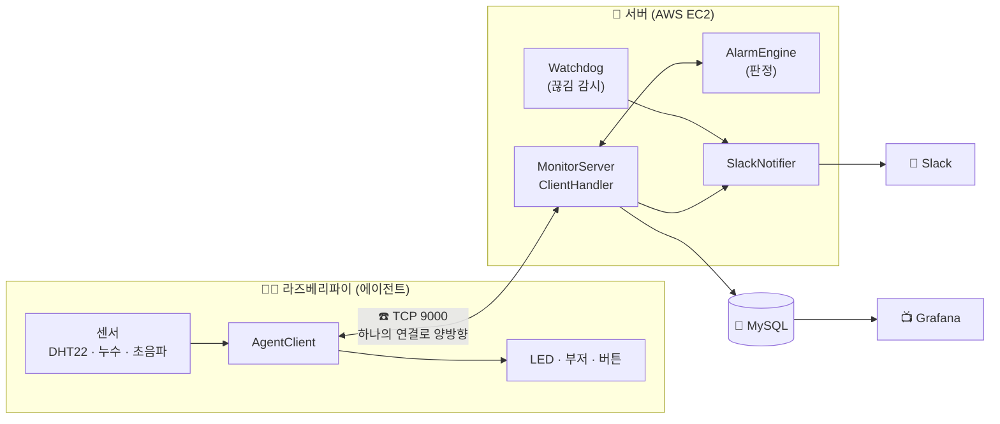
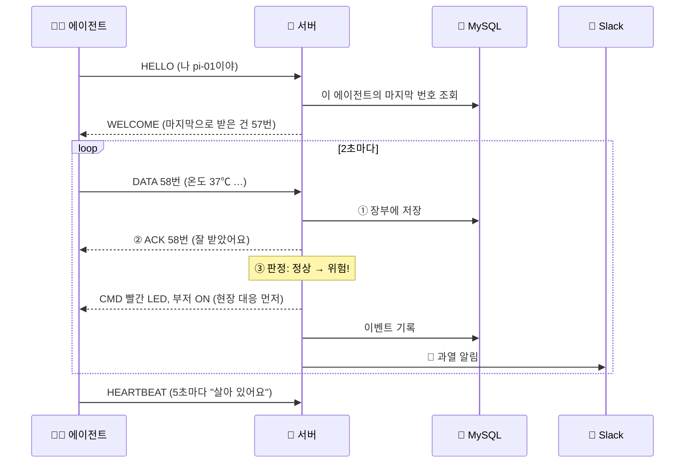
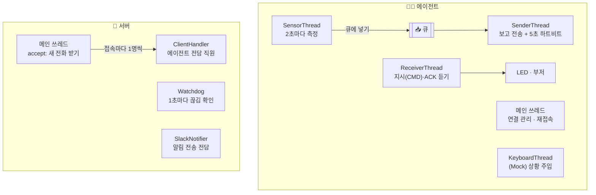

# 🏢 서버실(IDC) 환경·보안 관제 시스템

> 라즈베리파이가 서버실의 **온도·습도·누수·출입**을 지켜보다가, 이상이 생기면 서버가 판단해서
> **경광등(LED)과 부저를 원격으로 켜고 Slack으로 알려주는** IoT 관제 시스템입니다.

인터넷 통신 설계 수업 설계 프로젝트입니다. 순수 Python 표준 `socket`과 `threading`만으로 TCP 통신을 직접 설계했습니다.

---

## 📌 한눈에 보기: "현장 직원과 본사"로 이해하기

이 시스템은 **현장에 있는 직원**과 **멀리 있는 본사**가 전화 한 통으로 일하는 모습과 같습니다.

| 실제 구성 | 비유 | 하는 일 |
|---|---|---|
| 라즈베리파이 (에이전트) | 🧑‍🔧 서버실 현장 직원 | 2초마다 센서를 보고 본사에 보고 |
| AWS EC2 (서버) | 🏢 본사 관제실 | 보고를 받아 "위험한가?" 판단하고 지시 |
| TCP 연결 | ☎️ 계속 연결된 전화선 | 보고와 지시가 **한 통의 전화로 양쪽으로** 오감 |
| MySQL | 📒 장부 | 모든 보고와 사건을 기록 |
| Grafana | 📺 관제 화면 | 장부를 그래프로 보여줌 |
| Slack | 📱 담당자 휴대폰 | 상황이 바뀌면 문자로 알림 |
| LED / 부저 | 🚨 경광등 / 사이렌 | 본사 지시에 따라 현장에서 켜짐 |

```
🧑‍🔧 현장: "지금 온도 37도예요"  ──────☎️──────▶  🏢 본사: "위험! 기록하고…"
🚨 빨간불 + 사이렌 켜짐       ◀──────☎️──────   🏢 본사: "빨간불 켜, 부저 켜!"
                                                    └─▶ 📒 장부 기록, 📱 Slack 알림
```

---

## ✨ 주요 기능

- **실시간 센서 측정:** 온도·습도(DHT22), 누수 센서, 초음파 거리 센서(출입 감지)
- **서버 판정 + 원격 제어:** 상태에 따라 LED 색(초록·노랑·빨강·파랑)과 부저를 서버가 직접 제어
- **상태가 바뀔 때만 알림:** 매번 보내지 않고 "정상 → 위험"처럼 바뀌는 순간에만 지시·기록·알림
- **현장 버튼으로 경보 해제:** 부저는 바로 꺼지고, 원인이 사라질 때까지 LED는 유지
- **DB 저장 + 대시보드:** MySQL에 저장하고 Grafana에서 그래프·이벤트 표로 확인
- **Slack 알림:** 위험·경고·출입·에이전트 끊김을 휴대폰으로
- **끊김 감시(Watchdog):** 15초 동안 소식이 없으면 "현장 응답 없음" 알림
- **부품 없이도 실행 (Mock 모드):** PC에서 가짜 센서로 전체 시스템을 돌리고, 키보드로 상황을 연출

---

## 🗺️ 시스템 구조



---

## 🔄 한 번의 보고가 처리되는 과정



> **왜 이 순서인가요?**
> - **저장 → ACK:** 장부에 확실히 적은 뒤에만 "잘 받았어요"라고 답합니다. 못 적었으면 답을 안 해서, 현장이 나중에 다시 보낼 수 있게 합니다.
> - **CMD를 먼저:** 장부나 Slack이 느려도 빨간불은 바로 켜져야 하기 때문입니다.

---

## 🚦 판정 규칙

| 항목 | 조건 | 상태 | 현장 대응 |
|---|---|---|---|
| 누수 | 물 감지 | 🔴 DANGER | 빨간 LED + 부저 |
| 온도 | 35℃ 이상 | 🔴 DANGER | 빨간 LED + 부저 |
| 온도 | 30℃ 이상 | 🟡 WARN | 노란 LED |
| 습도 | 70% 이상 | 🟡 WARN | 노란 LED |
| 접근 | 30cm 안에 사람 | 🔵 ACCESS | 파란 LED + 출입 기록 |
| 그 외 | — | 🟢 NORMAL | 초록 LED, 부저 OFF |

- 여러 개가 겹치면 **빨강 > 노랑 > 파랑 > 초록** 순으로 하나만 켭니다.
- 기준값은 `.env`에서 바꿀 수 있습니다. 예를 들어 시연할 때 30℃ 대신 27℃로 낮출 수 있습니다.

---

## ☎️ TCP 프로토콜 설계

### 왜 "길이"를 앞에 붙이나요?
TCP는 **물을 흘려보내는 파이프**와 같습니다. 보낸 쪽은 메시지를 "한 컵, 두 컵" 나눠 부어도, 받는 쪽에는 **그냥 물줄기로** 섞여서 도착합니다.
그래서 메시지마다 맨 앞에 **"이번 메시지는 87바이트"라는 길이표**를 붙이고, 받는 쪽은 정확히 그만큼 다 받을 때까지 기다렸다가 자릅니다.

```
┌──────────────┬────────────────────────────────────────┐
│ 길이 (4바이트) │ 내용 (JSON, 5단계부터 AES 암호화)        │
└──────────────┴────────────────────────────────────────┘
```

### 메시지 종류

| type | 방향 | 뜻 |
|---|---|---|
| `HELLO` | 에이전트 → 서버 | 접속 인사, 내 이름(agent_id) 알림 |
| `WELCOME` | 서버 → 에이전트 | 인사 응답 + 마지막으로 저장된 번호(`last_seq`) |
| `DATA` | 에이전트 → 서버 | 번호(`seq`) + 측정 시각 + 센서 값 |
| `ACK` | 서버 → 에이전트 | "N번 장부에 저장했어요" |
| `HEARTBEAT` | 에이전트 → 서버 | 5초마다 "살아 있어요" |
| `EVENT` | 에이전트 → 서버 | 현장 버튼 눌림 (`ALARM_CLEAR`) |
| `CMD` | 서버 → 에이전트 | LED 색 바꿔, 부저 켜/꺼 |

예시 (DATA):
```json
{"type": "DATA", "agent_id": "pi-01", "ts": 1761700000.0, "seq": 58,
 "data": {"temperature": 37.2, "humidity": 45.1, "leak": false, "distance_cm": 150.3}}
```

---

## 🧵 쓰레드 구성: "여러 명의 직원이 동시에 일하기"

한 사람이 측정도 하고, 보고도 하고, 전화도 받으면 하나를 하는 동안 나머지가 멈춥니다. 그래서 **일마다 담당자(쓰레드)를 따로** 두었습니다.



| 쓰레드 | 비유 | 왜 따로 두나 |
|---|---|---|
| SensorThread | 측정 담당 | 연결이 끊겨도 측정은 계속해야 함 |
| SenderThread | 보고 담당 | 보내는 동안 듣기가 멈추면 안 됨 |
| ReceiverThread | 전화 듣는 담당 | 서버 지시가 언제 올지 모름 |
| ClientHandler | 에이전트 1대당 전담 직원 | 여러 현장이 동시에 접속해도 서로 안 막힘 |
| Watchdog | 순찰 담당 | "요즘 소식 없는 현장" 확인 |
| SlackNotifier | 문자 발송 담당 | Slack이 느려도 경보 처리는 멈추지 않게 |

**공유하는 물건에는 열쇠(Lock)를 답니다.** 버튼과 SenderThread가 같은 전화기(소켓)에 동시에 말하면 말이 섞이기 때문에, `send_lock`으로 한 번에 한 명만 쓰게 합니다. DB 연결, 접속 목록, 판정 상태도 같은 이유로 Lock으로 보호합니다.

---

## 🛡️ 고장에 강하게 만든 장치들

| 상황 | 대응 |
|---|---|
| 같은 보고가 두 번 옴 | 장부에서 `(agent_id, seq)` 중복을 막음 → 저장 안 하고 ACK만 |
| 에이전트를 껐다 켬 | WELCOME으로 마지막 번호를 알려줘 번호가 이어짐 |
| DB가 죽음 | 서버와 경보는 계속 동작, 10초간 재접속을 미뤄 경보가 늦지 않게 |
| Slack이 느림·실패 | 별도 쓰레드 + 3초 타임아웃, 실패해도 서버는 계속 |
| 현장 연결이 끊김 | 15초간 소식 없으면 `AGENT_OFFLINE` 알림, 돌아오면 `AGENT_ONLINE` |
| 서버를 두 개 켬 (Windows) | `SO_EXCLUSIVEADDRUSE`로 같은 포트 중복 사용을 막음 |
| 보내다가 연결이 끊김 | 보내기 전에 **확인 대기함**에 먼저 넣어 둠 → 재연결 후 다시 보냄 |
| 끊긴 동안의 측정값 | **대기함**(최대 1000개)에 쌓았다가 재연결 후 순서대로 전송 |
| 서버가 저장을 못 함 (ACK 없음) | 10초 뒤 같은 번호로 재전송 |
| 서버가 오래 꺼짐 | 재접속 간격 1 → 2 → 4 → 8 → 10초 (지수 백오프) |
| 도청·위조 | AES-256-GCM 암호화, 키가 다르거나 조작되면 연결을 끊음 |

---

## 🧰 기술 스택

| 구분 | 사용 기술 |
|---|---|
| 언어 | Python 3 (표준 `socket`, `threading`, `queue`) |
| 현장 장치 | Raspberry Pi, DHT22, 누수 센서, HC-SR04, RGB LED, 액티브 부저, 버튼 (`gpiozero`) |
| 서버 | AWS EC2 |
| 저장 / 시각화 | MySQL 8.4, Grafana 11.4 (Docker Compose) |
| 알림 | Slack Incoming Webhook |
| 보안 | AES-256-GCM (`cryptography`) |

---

## 📁 폴더 구조

```
idc-monitor/
├─ common/          # 에이전트와 서버가 함께 쓰는 코드
│  ├─ protocol.py   #   길이 붙이기/자르기, 메시지 만들기
│  ├─ crypto.py     #   암호화 (5단계)
│  └─ config.py     #   .env 읽기, 로그 설정
├─ agent/           # 🧑‍🔧 라즈베리파이에서 실행
│  ├─ client.py     #   연결·재접속, 송신/수신 쓰레드
│  ├─ sensors.py    #   센서 (Mock 포함), 키보드 상황 주입
│  └─ actuators.py  #   LED·부저 (Mock 포함)
├─ server/          # 🏢 서버에서 실행
│  ├─ tcp_server.py #   accept, 접속별 ClientHandler
│  ├─ alarm.py      #   AlarmEngine: 판정
│  ├─ db.py         #   MySQL 저장
│  ├─ notifier.py   #   Slack 알림 쓰레드
│  └─ watchdog.py   #   끊김 감시 쓰레드
├─ docker/          # MySQL + Grafana (대시보드 자동 등록)
└─ docs/devlog.md   # 📔 개발 일지
```

---

## ▶️ 실행 방법 (PC에서 부품 없이)

**1. 준비**
```bash
cp .env.example .env              # 값 채우기 (DB 비밀번호, Slack 주소 등)
py -m pip install -r server/requirements.txt
```

**2. MySQL + Grafana 켜기** (선택, 없으면 저장 없이 동작)
```bash
docker compose --env-file .env -f docker/docker-compose.yml up -d
```

**3. 서버 실행** (터미널 1)
```bash
py -m server.main
```

**4. 에이전트 실행** (터미널 2, `.env`에 `USE_MOCK=1`)
```bash
py -m agent.main
```

**5. 확인:** Grafana `http://localhost:3000` → "서버실 환경·보안 관제" 대시보드

> 라즈베리파이·Linux에서는 `py` 대신 `python3`을 씁니다.

---

## 🎬 시연 시나리오 (에이전트 창에 글자 입력 + Enter)

| 키 | 상황 | 기대 결과 |
|---|---|---|
| `t` | 과열 (36~38℃) | 🔴 빨간 LED + 부저, Slack 위험 알림 |
| `w` | 고온 경고 (31~33℃) | 🟡 노란 LED |
| `l` | 누수 켜기/끄기 | 🔴 빨간 LED + 부저 |
| `a` | 사람 접근 켜기/끄기 | 🔵 파란 LED + 출입 기록 |
| `b` | 경보 해제 버튼 | 🔇 부저만 꺼짐, LED는 원인이 사라질 때까지 유지 |
| `n` | 정상 복귀 | 🟢 초록 LED |
| (에이전트 종료) | 현장 끊김 | 15초 뒤 Slack "응답 없음" 알림 |

---

## 📈 진행 상황

- [x] 1단계: TCP 프로토콜 + 기본 통신
- [x] 2단계: 양방향 통신 + 상태 판정
- [x] 3단계: MySQL 저장 + Grafana + ACK
- [x] 4단계: Slack 알림 + 하트비트 + Watchdog
- [x] 5단계: 재전송 버퍼 + 재연결 백오프 + AES 암호화
- [x] 6단계: 실제 하드웨어 (GPIO)
- [ ] 7단계: 배포 (EC2 + Docker)

단계별로 무엇을 했고, 어떤 문제를 만나 어떻게 풀었는지는 **[📔 개발 일지](docs/devlog.md)**에 정리했습니다.

---

## 📖 용어 사전 (처음 보는 분을 위해)

| 용어 | 쉬운 설명 |
|---|---|
| TCP | 순서대로, 빠짐없이 도착을 보장하는 통신 방식. "계속 연결된 전화" |
| 소켓 (socket) | 프로그램이 네트워크에 말하고 듣는 "전화기" |
| 포트 (port) | 한 컴퓨터 안의 "내선 번호" (이 프로젝트는 9000번) |
| 쓰레드 (thread) | 한 프로그램 안에서 동시에 일하는 "직원" |
| Lock | 공유 물건을 한 번에 한 명만 쓰게 하는 "열쇠" |
| 큐 (queue) | 먼저 넣은 것부터 꺼내는 "대기 줄" |
| 프레이밍 | 물줄기 같은 TCP 데이터를 메시지 단위로 "자르는 규칙" |
| JSON | `{"온도": 25}`처럼 사람도 읽을 수 있는 데이터 형식 |
| ACK | "잘 받았어요"라는 확인 답장 |
| seq | 보고마다 붙이는 "번호표". 빠짐·중복 확인용 |
| 하트비트 | "살아 있어요" 신호 |
| Watchdog | 신호가 끊긴 걸 알아채는 "감시견" |
| Mock | 실제 부품 대신 쓰는 "가짜 부품" (PC 테스트용) |
| AES-GCM | 내용을 잠그고(암호화) 위조 여부까지 확인하는 방식 |
| Webhook | 정해진 주소로 보내기만 하면 Slack에 글이 올라가는 "우체통" |
